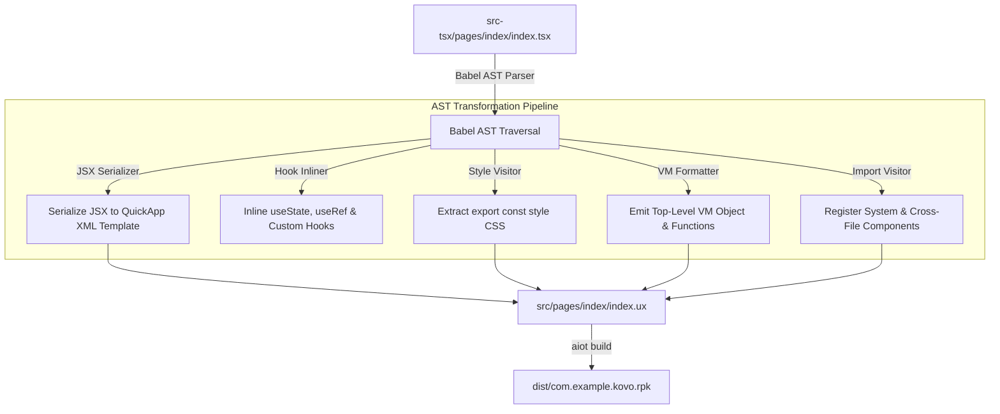

# 02. Architecture & Compiler Pipeline

This document explains the inner workings of the **Kovo AST Transformation Engine** (`scripts/babel-plugin-vela-ux.js`) and how standard React TSX code is converted into native Xiaomi Vela QuickApp `.ux` markup and JavaScript.

---

## 🏗️ Compiler Architecture Diagram



---

## 🔬 Core Compiler Transformations

### 1. Custom Hook Inlining

When custom hooks (functions starting with `use[A-Z]`) are invoked inside a component, the compiler **inlines their state and methods directly into the component VM**.

#### Input TSX:
```tsx
function useCounter(initialCount = 10) {
  const [count, setCount] = useState(initialCount);
  function inc() { setCount(count + 1); }
  function dec() { setCount(count - 1); }
  return { count, inc, dec };
}

export default function CounterPage() {
  const { count, inc, dec } = useCounter(5);
  return <text>{count}</text>;
}
```

#### Output `.ux` `<script>`:
```javascript
export default {
  data: { count: 5 },
  inc() {
    this.count = this.count + 1;
  },
  dec() {
    this.count = this.count - 1;
  }
}
```

> [!NOTE]
> Top-level `function useCounter(...)` is automatically pruned from the output `<script>` block. This prevents `ReferenceError: useState is not defined` when loaded by the QuickJS runtime.

---

### 2. Xiaomi Vela OS VM Compliance Protocol

In Vue.js or standard Webpack QuickApp frameworks, methods are traditionally wrapped in a `methods: { ... }` object.

However, in **Xiaomi Vela QuickJS VM (NuttX kernel)**, methods **MUST be properties of the top-level `export default` object**:

```javascript
// ✅ CORRECT (Vela OS Compliant Generated Output):
export default {
  data: { steps: 8450 },
  addSteps() {
    this.steps = this.steps + 500;
  },
  resetSteps() {
    this.steps = 0;
  }
}

// ❌ INCORRECT (Triggers "TypeError: not a function" on button click):
export default {
  data: { steps: 8450 },
  methods: {
    addSteps() { this.steps = this.steps + 500; }
  }
}
```

Kovo automatically emits all component methods directly on `export default`, guaranteeing 100% native compatibility.

---

### 3. Header Import Placement Rule

QuickApp template specification requires `<template>` to contain **exactly one root element** (`<div class="page">`).

Custom component `<import>` tags are emitted **at the top-level above `<template>`**:

```xml
<!-- ✅ CORRECT (emitted before <template>): -->
<import name="stat-card" src="../../components/StatCard/StatCard.ux"></import>

<template>
  <div class="page">
    <stat-card title="DAILY STEPS" />
  </div>
</template>
```

---

### 4. Extensionless Import Resolution

Developers frequently import components without file extensions:

```tsx
import StatCard from '../../components/StatCard/StatCard';
```

The compiler identifies relative capital-cased default imports (`/^[A-Z]/`) and automatically resolves the destination to `.ux`:

```xml
<import name="stat-card" src="../../components/StatCard/StatCard.ux"></import>
```

---

### 5. Top-Level Local Variable Auto-Registration

Local variables declared inside functional components (such as constant arrays or data models) are automatically added to `data: { ... }` so QuickApp template directives (`for="{{w in workouts}}"`) can resolve them reactively:

#### Input TSX:
```tsx
export default function WorkoutsPage() {
  const workouts = WORKOUTS;
  return <div for={w in workouts}>{w.name}</div>;
}
```

#### Output `.ux`:
```javascript
export default {
  data: { workouts: WORKOUTS }
}
```
This eliminates `[ERROR] [AIOTJS] [JsForCallRender] need a array` errors during template rendering.
